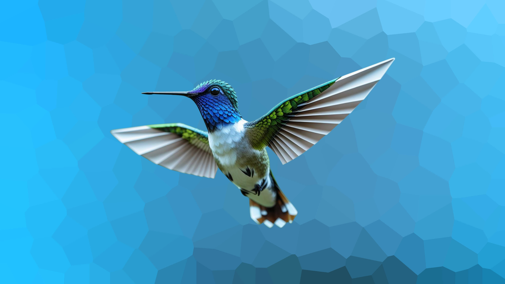
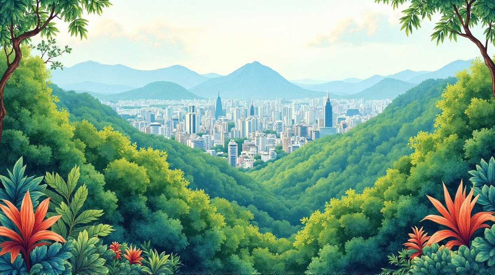
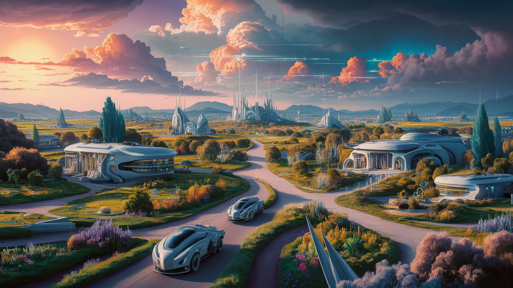
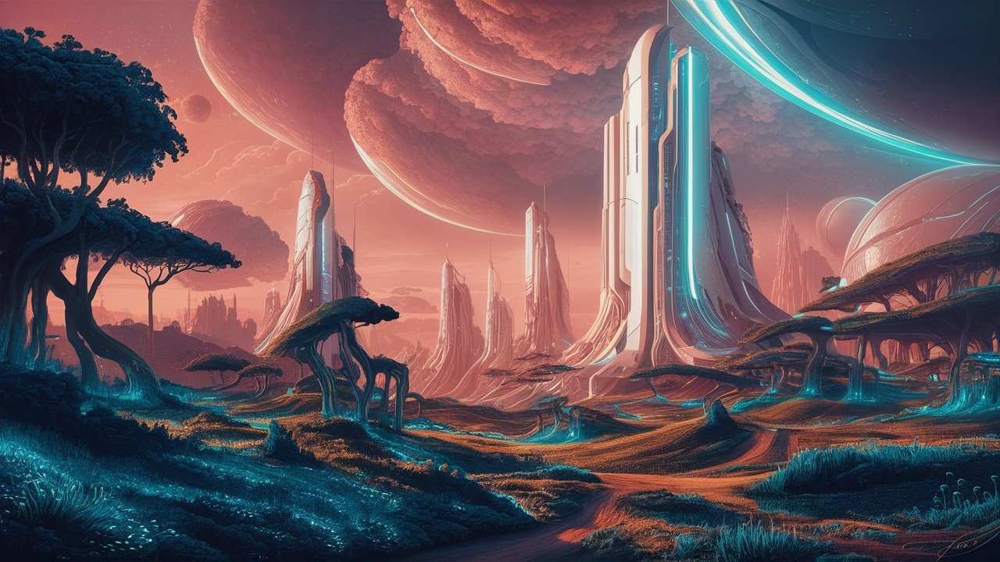

<div align="center">


# Mainuan Wallpapers

Papéis de parede do **Mainuan Linux** para o KDE Plasma, empacotados como `mainuan-wallpapers`.

[](https://github.com/mainuan/wallpapers/actions/workflows/ci.yml)
[](https://github.com/mainuan/wallpapers/releases)
[](LICENSE)


[English](README.en.md)

</div>

---

| | | |
|:-:|:-:|:-:|
|  |  |  |
| `01ciano.png` (padrão) | `04violet.png` | `beija-flor1.png` |
|  |  |  |
| `photo_2025-11-24_11-22-50.jpg` | `a_breathtaking_….jpeg` | `a_captivating_….jpeg` |

As imagens acima são arquivos deste repositório, exibidos em tamanho reduzido.

## O que é

Este repositório reúne os papéis de parede do Mainuan. O pacote Debian
`mainuan-wallpapers` instala os 27 arquivos de imagem da raiz em
`/usr/share/wallpapers`, de onde o Plasma os oferece em
**Configurar área de trabalho e papel de parede**.

O pacote vem instalado na ISO do Mainuan. O papel de parede padrão
(`01ciano.png`) não é definido aqui, e sim pelo
[`mainuan-desktop-defaults`](https://github.com/mainuan/dot-files).

## O que o pacote contém

| Grupo | Arquivos | Formato |
|---|---|---|
| Cores de destaque do Mainuan | `01ciano`, `02cinza`, `03magenta`, `04violet`, `05marrom`, `06lima` | PNG, 1920×1080 |
| Beija-flor | `beija-flor1` a `beija-flor3` | PNG |
| Ilustrações | `a_*.png` e `a_*.jpeg` (8 arquivos) | PNG e JPEG |
| Fotos | `photo_2025-11-24_11-22-50` a `…-52` | JPEG |
| Amanhecer e outros | `amanhecer-01` a `-04`, `bj-art-3`, `bj-art-9`, `tropicale` | JPEG XL |

As seis cores de destaque são as mesmas usadas pelo aplicativo de boas-vindas,
pelos temas de ícones [Kora do Mainuan](https://github.com/mainuan/icons) e
pelos esquemas de cores Dream do
[`mainuan-plasma-themes`](https://github.com/mainuan/plasma-themes).

Os arquivos `.jxl` (JPEG XL) são abertos pelo Plasma com o
`kimageformat6-plugins`, que o pacote recomenda.

## Instalação

O pacote já vem na ISO do Mainuan. Para instalar ou atualizar à mão, baixe o
`.deb` e o `SHA256SUMS` da
[última release](https://github.com/mainuan/wallpapers/releases/latest):

```bash
sha256sum --check --ignore-missing SHA256SUMS
sudo apt install ./mainuan-wallpapers_*_all.deb
```

O GitHub Releases não é um repositório APT: as atualizações chegam por novas
versões do pacote ou pela ISO.

## Convivência com o Kubuntu

O pacote só acrescenta arquivos novos em `/usr/share/wallpapers`:

- não substitui nem desvia (`dpkg-divert`) nenhum arquivo de outro pacote;
- os papéis de parede do Kubuntu e do Plasma (`breeze-wallpaper`,
  `kubuntu-wallpapers`, `plasma-workspace-wallpapers`) continuam intactos;
- a pasta `Next/`, que antes sobrescrevia arquivos desses pacotes, foi removida
  na versão 2026.11.17.

O CI confere isso a cada build (veja abaixo).

## Adicionar ou trocar um papel de parede

1. Coloque a imagem na raiz do repositório, em PNG, JPEG ou JPEG XL
   (`debian/install` instala `*.png`, `*.jpg`, `*.jpeg` e `*.jxl`).
2. Atualize a contagem esperada de imagens no teste de fumaça de
   `.github/workflows/ci.yml` (`test "$n" -eq 27`).
3. Registre a mudança em `debian/changelog` (`dch -v <nova versão>`).
4. Abra um pull request. A release é publicada quando a tag `v<versão>`,
   igual à de `debian/changelog`, é enviada.

Antes de adicionar uma imagem de terceiros, confirme que a licença permite a
redistribuição e registre o autor em `debian/copyright`.

## Informações técnicas

| Item | Valor |
|---|---|
| Pacote | `mainuan-wallpapers` (`Architecture: all`) |
| Destino | `/usr/share/wallpapers` |
| Base | Kubuntu 26.04 LTS, KDE Plasma 6.6 |
| Empacotamento | debhelper 13, formato `3.0 (native)` |
| Recomenda | `kimageformat6-plugins` (JPEG XL) |

## Compilação e testes

```bash
dpkg-buildpackage -us -uc -b
```

O [CI](.github/workflows/ci.yml) usa o pipeline compartilhado
[`mainuan/.github`](https://github.com/mainuan/.github) num contêiner
Ubuntu 26.04 e:

1. confere que o pacote-fonte não leva `.git` nem sobras de build;
2. compila com `dpkg-buildpackage` e passa o `lintian` (falha em erro);
3. instala o pacote num Ubuntu 26.04 limpo, com os papéis de parede do Kubuntu
   já instalados;
4. confere o tipo de cada uma das 27 imagens (`file`) e a resolução
   1920×1080 das seis cores de destaque;
5. confere com `dpkg --verify` que os pacotes do Kubuntu continuam intactos e
   que não há nenhum desvio;
6. reinstala, remove e expurga o pacote, sem sobras.

Uma tag `v<versão>` publica o `.deb` e o `SHA256SUMS` na release.

## Contribuição

Relate problemas em [Issues](https://github.com/mainuan/wallpapers/issues) e
envie mudanças por pull request. O CI roda em cada pull request, em
[Actions](https://github.com/mainuan/wallpapers/actions).

## Créditos

- **Daigo** ([daigoasuka](https://github.com/daigoasuka)): coleção de papéis de
  parede.
- **Rafael Ruscher** ([ruscher](https://github.com/ruscher)): empacotamento
  Debian e CI.

## Licença

[GNU GPL versão 3](LICENSE). Segundo o `debian/copyright`, a licença vale para
todas as imagens (© 2025-2026 daigo e colaboradores do Mainuan).
